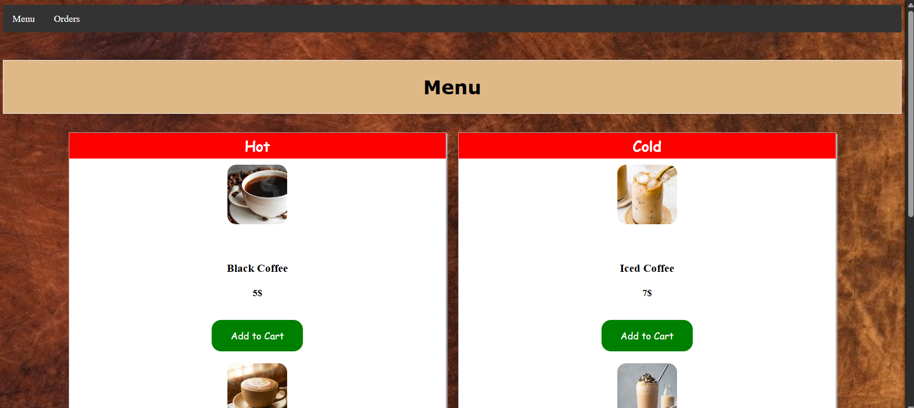

# Ordering System for Jessica
## A Cafe Like Website Displaying an ordering system
**Website DEMO URL:** 
### Sections
- *Menu Page* displaying two columns of drinks, hot, and cold drinks which you can order and add to your cart.
- *Slide Cart* you can access to see the cart you added your drinks to, which you can access the checkout page by.
- *Checkout Page* you can access by a "proceed to checkout" button in the slide cart. The page is accessible only if you have items in your cart.
- *Checkout Form* in the checkout page which asks for your card information and shows the items you put in your cart.
- *Orders Tab* Shows you all the orders you ordered. An order shows up after you click on the submit button in the checkout form.
### Features
- The checkout form has a beautiful card spin when you hover upon it with your cursor. The whole form without the cart display was done by watching a tutorial made by "Ahmed Shaheen", his Youtube channel: "https://www.youtube.com/@ahmedshaheen4304", The video I used its tutorial: "https://www.youtube.com/watch?v=tezm1Azaa4Y"
- The navbar which is shown in the menu, and the orders tabs I learned from w3schools how to make it: "https://www.w3schools.com/css/css_navbar_horizontal.asp"
- Most of the menu page was done using a tutorial made by "https://www.youtube.com/@MaduWebTech" the video: "https://www.youtube.com/watch?v=tmLHtoXxU98&t=530s"
### Unique Features
- The orders tab and the localStorage used in it to display and save the orders the user ordered.
- The slide cart in the menu page.
### What I learned through the process of making this website
- The localStorage feature in javaScript language and some css
